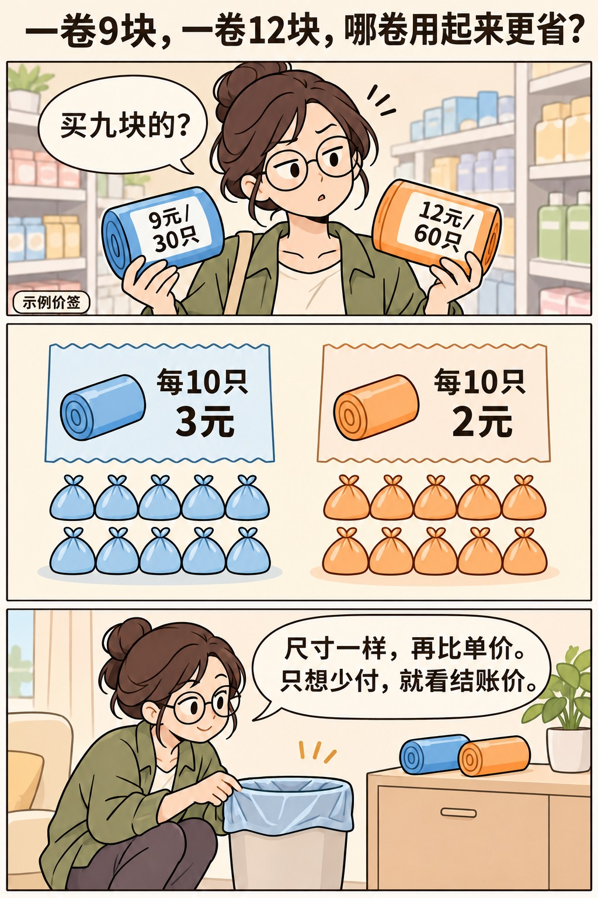
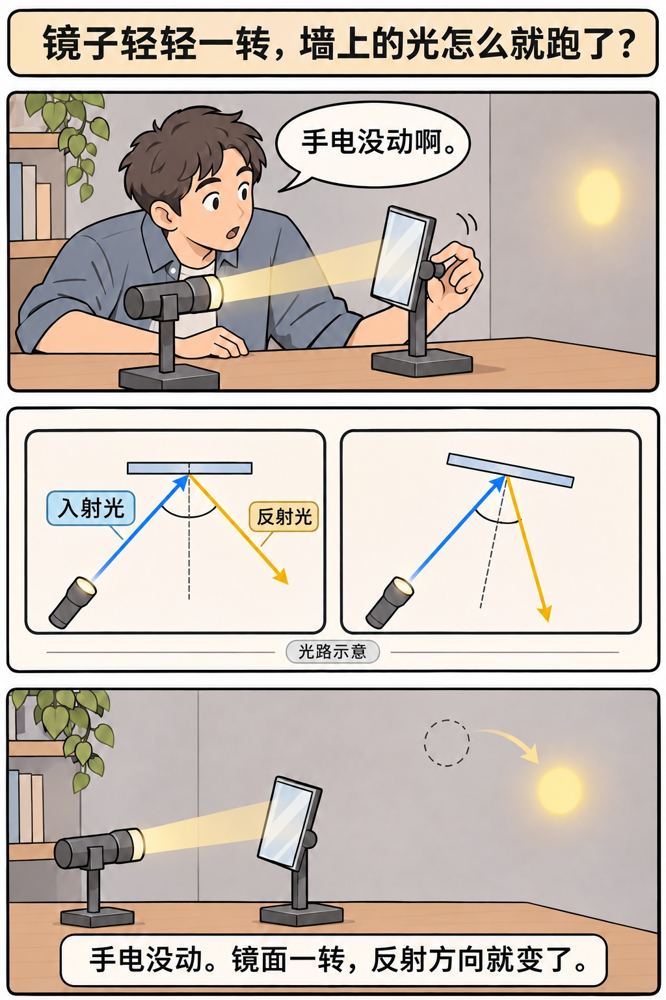
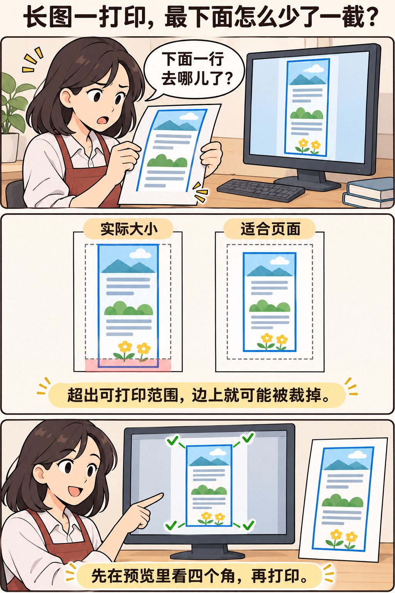

# 知识漫画 Skills
九块钱一卷的垃圾袋，怎么用起来比十二块的还贵？转一下镜子，墙上的光怎么就跑了？长图打印少了一截，该改哪个选项？这套知识漫画 Skills 从读者身边的疑问出发，把比较、原理和做法编成看得懂的分镜。创作技能帮你选题、拟标题、写每页的画面和对白，再按确认的脚本准备出图。审稿技能逐页核对来源、算式、箭头和操作条件，指出哪一格会让人看错，给出可以直接替换的文字或画法。三个原创案例都附样图、分镜和审稿要点，能看懂怎么算账、怎样画清原理、怎么把步骤放进画面。适合公众号创作者、科普作者和想把复杂问题讲明白的老师。复制到 Codex 项目即可使用。两个技能可以单独调用，已有漫画也能只审你指定的一页。演示数据和图解条件都在对应位置标清，一眼就能找到。
## 看三个漫画案例

- [垃圾袋怎么比价](examples/price-comparison/README.md) 用相同只数比单价。
- [转镜子为什么会移动光斑](examples/mirror-reflection/README.md) 从动作切到两幅对照图。
- [长图打印怎么保住四角](examples/print-preview/README.md) 在预览里辨认裁切和缩放。
## 两个技能
- [knowledge-comic-craft](skills/knowledge-comic-craft/SKILL.md) 从选题到分镜与出图准备。可单独做选题、脚本或画图。
- [knowledge-comic-review](skills/knowledge-comic-review/SKILL.md) 审已有脚本和成图。按页检查来源、计算、图解和读者能否照着做。
## 在 Codex 里使用
把 `skills/` 里的两个技能文件夹复制到项目的 `.agents/skills/`。在那个项目里，输入 `$knowledge-comic-craft` 或 `$knowledge-comic-review` 可直接指定技能。
- 想写脚本可以说「用 `$knowledge-comic-craft`，写一篇六页漫画。两种垃圾袋包装的价签在下面，讲清哪种每只便宜、今晚急用少量时又该怎么买。每页标明格数、画面、对白和必要图注。」
- 想审稿可以说「用 `$knowledge-comic-review` 审我上传的第2、3页。指出算式和箭头哪里会误导读者，直接给需要改的画面与短图注。」
- [看一篇完整示例](skills/knowledge-comic-craft/references/price-comparison.md) · [看审稿如何定位问题](skills/knowledge-comic-review/references/review-examples.md)
## 文件与权限
两个技能文件夹只有 Markdown。安装时直接复制技能文件夹。三个案例的样图和分镜放在 `examples/`。完成图像或联网查资料需要当前环境具备相应工具，并遵守该任务的授权范围。公开示例采用自编情境和明确标注的演示数据。对外上传、发草稿和发布分别按使用者授权执行。
## 许可
本仓库的技能文本与示例以 [MIT](LICENSE) 发布。使用者自行提供的资料、图片和作品沿用各自的授权范围。
