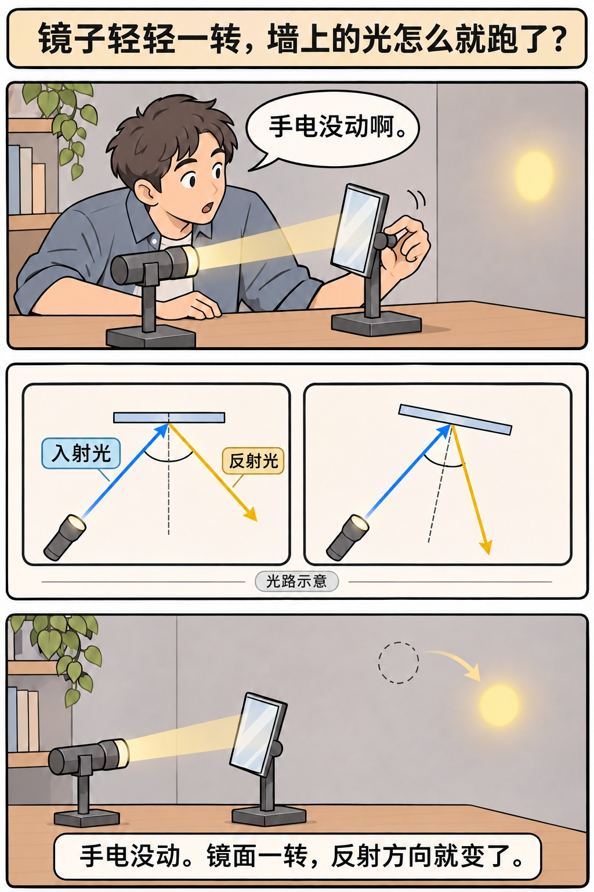

# 镜子轻轻一转，墙上的光怎么就跑了？

## 想让读者解决的问题
手电没挪，为什么轻轻一转镜子，墙上的光斑就换位置了？
## 一页三格
1. 手电固定在支架上，小镜子把光照到墙上。人物伸手轻转镜面，视线跟着光斑走。
2. 俯视图并排。两图保留相同的手电、镜面中心和入射方向，只改变镜面的角度。蓝箭头指向镜面，金箭头从镜面离开。对每个镜面，入射光与反射光和镜面法线所成的角相等。
3. 墙上用虚线圈标旧位置，实心光斑标新位置。读者能看出光源没动，改变的是反射光能照到哪里。
## 审图
别把旧光斑画成另一束还亮着的光。两幅机制图的反射箭头分别由各自镜面的方向确定。
[事实依据](https://openstax.org/books/physics/pages/16-1-reflection)
