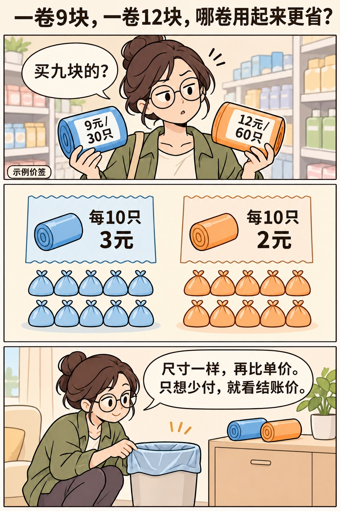

# 一卷9块，一卷12块，哪卷用起来更省？

## 想让读者解决的问题
遇到整卷价格和只数不一样的两种包装，怎么比用起来哪卷便宜？
## 一页三格
1. 货架前，两款同尺寸、同用途的垃圾袋，每卷分别是「9元／30只」「12元／60只」。人物先伸手拿9元那卷。
2. 并列两张小票，各标「每10只」。蓝卷是 9 ÷ 30 × 10＝3元，橙卷是 12 ÷ 60 × 10＝2元。相同分母放到一样醒目的位置。
3. 回家看垃圾桶。假如两卷同样适用，长期补货可以比单价，这次只想少付钱就看结账价。
## 审图
两卷规格相同才比较单价。价格与只数是演示数据。这次付得少和同样数量买得便宜，是两笔不同的账。
[六页展开版](../../skills/knowledge-comic-craft/references/price-comparison.md)
