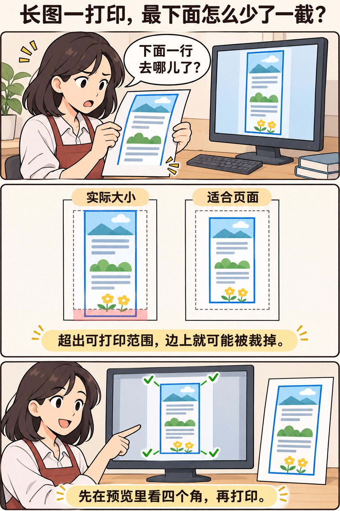

# 长图一打印，最下面怎么少了一截？

## 想让读者解决的问题
把长图当一页打印时，怎样在点打印前发现会少一截？
## 一页三格
1. 屏幕上的图有完整蓝框，纸上少了底边。人物把纸放到屏幕旁比对。
2. 左右两张纸用相同的虚线画出可打印范围。「实际大小」的长图越界。「适合页面」等比例缩进去，四角都留在虚线内。
3. 在打印预览里找到四个角，再点打印。如果想留住原字号，可以换大纸或把长图拆成几页。
## 审图
纸张边界和可打印范围用不同线型。缩放后的字会变小，还要在预览里看清字。软件选项名称和可打印范围随软件、打印机与纸张设置变化。
[操作依据](https://helpx.adobe.com/acrobat/desktop/print-documents/set-up-and-print-pdfs/page-size.html)
